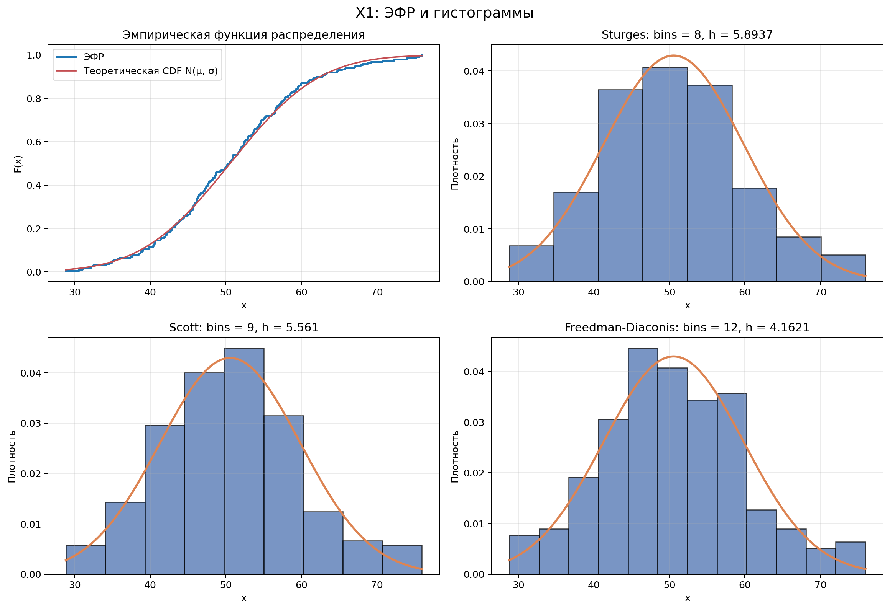
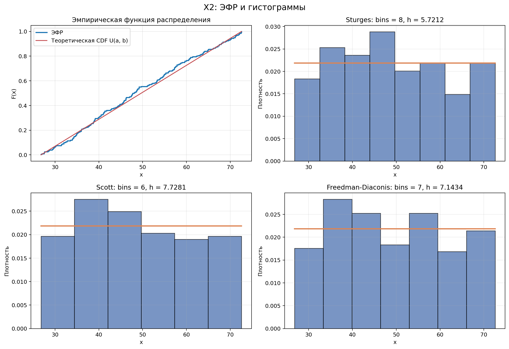
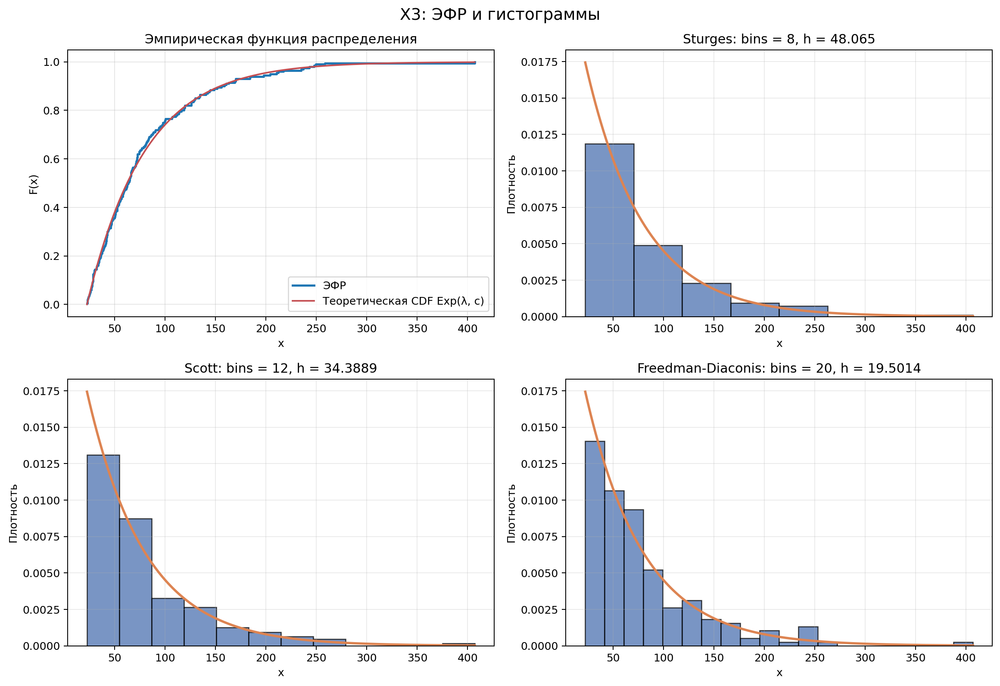
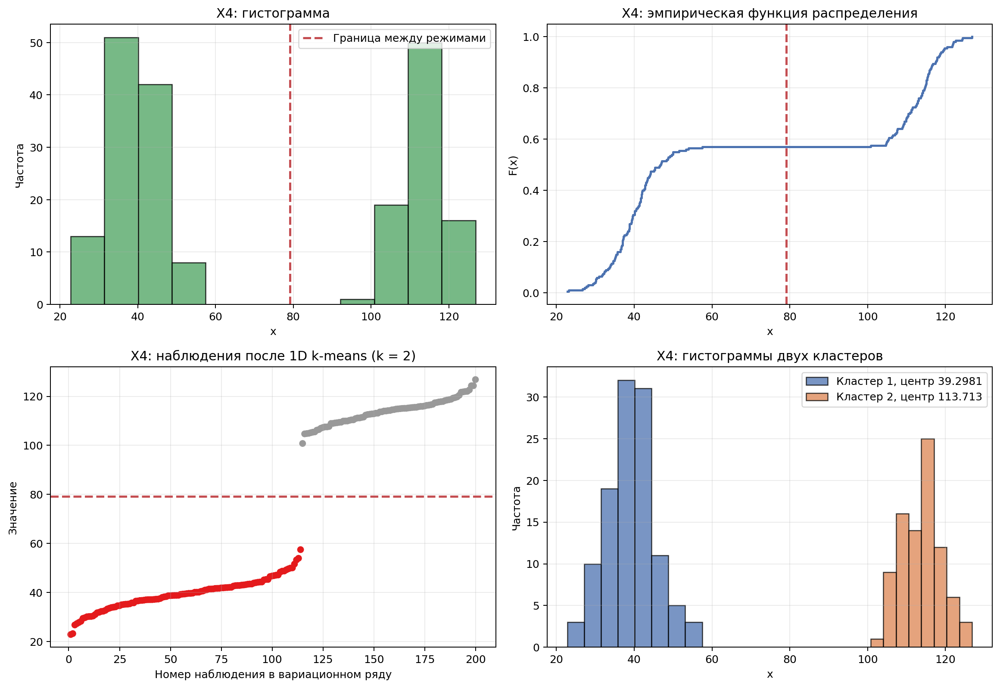

# РГР 1 по математической статистике

## 1. Общие сведения

Идентификатор варианта: **A-2**.

Источник данных: `RGR1_A-2_X1-X4.csv`.

Объём выборки: **n = 200**.

Для столбцов X1, X2, X3 выполнены обязательные пункты задания: первичное описание выборки, выбор модели распределения, оценивание параметров методом моментов и методом максимального правдоподобия, оценивание вероятности события, оценивание моментов по сгруппированной выборке и построение доверительных интервалов. Для X4 выполнено первичное описание и бонусное разбиение на два кластера.

## 2. Столбец X1

Модель: **N(μ, σ)**

Графики: 

### 2.1 Первичное описание выборки

Фрагмент вариационного ряда приведён ниже; полный вариационный ряд вынесен в приложение и сохранён в `output/variation_series/X1_variation_series.csv`.

| i | x_(i) |
| ---: | ---: |
| 1 | 28.81 |
| 2 | 30.54 |
| 3 | 31.03 |
| 4 | 31.11 |
| 5 | 32.17 |
| ... | ... |
| 196 | 72.3 |
| 197 | 73.92 |
| 198 | 75.15 |
| 199 | 75.6 |
| 200 | 75.96 |

### Числовые характеристики

| Показатель | Значение |
| --- | ---: |
| n | 200 |
| min | 28.81 |
| max | 75.96 |
| Среднее x̄ | 50.5689 |
| Смещённая дисперсия S² | 86.3364 |
| Несмещённая дисперсия σ̂² | 86.7702 |
| S | 9.2917 |
| σ̂ | 9.3151 |
| Медиана | 50.335 |
| q0.10 | 39.009 |
| q0.25 | 44.39 |
| q0.75 | 56.56 |
| q0.90 | 62.091 |
| Асимметрия | 0.2686 |

Распределение близко к симметричному: коэффициент асимметрии 0.2686, среднее (50.5689) и медиана (50.335) почти совпадают. Наблюдения лежат в диапазоне [28.81; 75.96], выраженной естественной границы нет.

### 2.2 Предположение о виде закона распределения

По визуальной форме гистограммы и ЭФР лучше всего подходит N(μ, σ). Дополнительно использована KS-подобная метрика для трёх моделей: N(μ, σ): 0.0401; U(a, b): 0.2091; Exp(λ, c): 0.2919.

### 2.3 Оценивание параметров: метод моментов и метод максимального правдоподобия

Метод моментов:

Теоретические моменты: E[X] = μ, D[X] = σ². Приравниваем их выборочным характеристикам: μ = x̄ = 50.5689, σ² = S² = 86.3364. Отсюда μ̂_MM = 50.5689, σ̂_MM = S = 9.2917.

Метод максимального правдоподобия:

Логарифм правдоподобия для выборки объёма n = 200: ℓ(μ, σ) = -n ln σ - (n / 2) ln(2π) - (1 / (2σ²)) Σ (x_i - μ)². Максимум достигается в точке μ̂_MLE = x̄ = 50.5689, σ̂²_MLE = S² = 86.3364, то есть σ̂_MLE = 9.2917.

Итоговые оценки:

| Метод | Оценки параметров |
| --- | --- |
| Метод моментов | μ = 50.5689, σ = 9.2917 |
| ММП | μ = 50.5689, σ = 9.2917 |

Метод моментов даёт: μ = 50.5689, σ = 9.2917. ММП даёт: μ = 50.5689, σ = 9.2917.

### 2.4 Оценивание параметрической вероятности двумя способами

Выбран порог x0 = x̄ + σ̂ = 59.884. Эмпирическая оценка P(X > x0) = 0.14, параметрическая по методу моментов = 0.158, по ММП = 0.158.

### 2.5 Оценка моментов по сгруппированной выборке

| Оценка | По исходной выборке | По сгруппированной выборке |
| --- | ---: | ---: |
| EX | 50.5689 | 50.5186 |
| DX | 86.7702 | 89.1293 |

### 2.6 Доверительные интервалы

Асимптотический 95% ДИ для EX: (49.2779; 51.8599).

Точный 95% ДИ для μ: (49.27; 51.8678).

Точный 95% ДИ для σ²: (71.9591; 106.7026).

Интервал доверия 95% означает следующее: если многократно повторять процедуру выборки и строить интервалы по той же формуле, то примерно 95% таких интервалов будут накрывать истинный параметр. Это не вероятность того, что уже после наблюдения данных параметр лежит в конкретном построенном интервале.

## 3. Столбец X2

Модель: **U(a, b)**

Графики: 

### 3.1 Первичное описание выборки

Фрагмент вариационного ряда приведён ниже; полный вариационный ряд вынесен в приложение и сохранён в `output/variation_series/X2_variation_series.csv`.

| i | x_(i) |
| ---: | ---: |
| 1 | 26.8 |
| 2 | 27.0 |
| 3 | 27.53 |
| 4 | 27.57 |
| 5 | 27.62 |
| ... | ... |
| 196 | 72.04 |
| 197 | 72.11 |
| 198 | 72.46 |
| 199 | 72.54 |
| 200 | 72.57 |

### Числовые характеристики

| Показатель | Значение |
| --- | ---: |
| n | 200 |
| min | 26.8 |
| max | 72.57 |
| Среднее x̄ | 49.0995 |
| Смещённая дисперсия S² | 166.7376 |
| Несмещённая дисперсия σ̂² | 167.5754 |
| S | 12.9127 |
| σ̂ | 12.9451 |
| Медиана | 47.9 |
| q0.10 | 32.354 |
| q0.25 | 38.2875 |
| q0.75 | 59.175 |
| q0.90 | 67.936 |
| Асимметрия | 0.1442 |

Данные почти равномерно заполняют интервал [26.8; 72.57]. Асимметрия мала (0.1442), среднее и медиана близки, выраженного хвоста нет.

### 3.2 Предположение о виде закона распределения

По визуальной форме гистограммы и ЭФР лучше всего подходит U(a, b). Дополнительно использована KS-подобная метрика для трёх моделей: U(a, b): 0.0606; N(μ, σ): 0.0795; Exp(λ, c): 0.1535.

### 3.3 Оценивание параметров: метод моментов и метод максимального правдоподобия

Метод моментов:

Теоретические моменты: E[X] = (a + b) / 2, D[X] = (b - a)² / 12. Система метода моментов: (a + b) / 2 = x̄ = 49.0995, (b - a)² / 12 = S² = 166.7376. После решения получаем â_MM = x̄ - √(3S²) = 26.7341, b̂_MM = x̄ + √(3S²) = 71.4649.

Метод максимального правдоподобия:

Функция правдоподобия: L(a, b) = (b - a)^(-n) · I{a ≤ x_(1), x_(n) ≤ b}, n = 200. Тогда ℓ(a, b) = -n ln(b - a) при выполнении ограничений на носитель. Чтобы максимизировать ℓ, нужно минимизировать длину интервала, содержащего всю выборку, поэтому â_MLE = x_(1) = 26.8, b̂_MLE = x_(n) = 72.57.

Итоговые оценки:

| Метод | Оценки параметров |
| --- | --- |
| Метод моментов | a = 26.7341, b = 71.4649 |
| ММП | a = 26.8, b = 72.57 |

Метод моментов даёт: a = 26.7341, b = 71.4649. ММП даёт: a = 26.8, b = 72.57.

### 3.4 Оценивание параметрической вероятности двумя способами

Выбран порог x0 = x̄ + σ̂ = 62.0446. Эмпирическая оценка P(X > x0) = 0.205, параметрическая по методу моментов = 0.2106, по ММП = 0.23.

### 3.5 Оценка моментов по сгруппированной выборке

| Оценка | По исходной выборке | По сгруппированной выборке |
| --- | ---: | ---: |
| EX | 49.0995 | 49.1946 |
| DX | 167.5754 | 163.2506 |

### 3.6 Доверительные интервалы

Асимптотический 95% ДИ для EX: (47.3054; 50.8936).

Интервал доверия 95% означает следующее: если многократно повторять процедуру выборки и строить интервалы по той же формуле, то примерно 95% таких интервалов будут накрывать истинный параметр. Это не вероятность того, что уже после наблюдения данных параметр лежит в конкретном построенном интервале.

## 4. Столбец X3

Модель: **Exp(λ, c)**

Графики: 

### 4.1 Первичное описание выборки

Фрагмент вариационного ряда приведён ниже; полный вариационный ряд вынесен в приложение и сохранён в `output/variation_series/X3_variation_series.csv`.

| i | x_(i) |
| ---: | ---: |
| 1 | 22.47 |
| 2 | 22.76 |
| 3 | 22.89 |
| 4 | 22.98 |
| 5 | 23.53 |
| ... | ... |
| 196 | 242.97 |
| 197 | 247.71 |
| 198 | 249.2 |
| 199 | 258.37 |
| 200 | 406.99 |

### Числовые характеристики

| Показатель | Значение |
| --- | ---: |
| n | 200 |
| min | 22.47 |
| max | 406.99 |
| Среднее x̄ | 79.8089 |
| Смещённая дисперсия S² | 3301.5753 |
| Несмещённая дисперсия σ̂² | 3318.1661 |
| S | 57.4593 |
| σ̂ | 57.6035 |
| Медиана | 63.35 |
| q0.10 | 28.346 |
| q0.25 | 41.16 |
| q0.75 | 98.1825 |
| q0.90 | 156.211 |
| Асимметрия | 1.9827 |

Выборка имеет сильную правостороннюю асимметрию (1.9827), минимум 22.47 задаёт естественную левую границу, а правый хвост заметно растянут. Среднее (79.8089) существенно больше медианы (63.35).

### 4.2 Предположение о виде закона распределения

По визуальной форме гистограммы и ЭФР лучше всего подходит Exp(λ, c). Дополнительно использована KS-подобная метрика для трёх моделей: Exp(λ, c): 0.0364; N(μ, σ): 0.1692; U(a, b): 0.5732.

### 4.3 Оценивание параметров: метод моментов и метод максимального правдоподобия

Метод моментов:

Теоретические моменты: E[X] = c + 1 / λ, D[X] = 1 / λ². Система метода моментов: c + 1 / λ = x̄ = 79.8089, 1 / λ² = S² = 3301.5753. Отсюда λ̂_MM = 1 / S = 0.0174, ĉ_MM = x̄ - S = 22.3496.

Метод максимального правдоподобия:

Функция правдоподобия: L(λ, c) = λ^n exp(-λ Σ(x_i - c)) · I{c ≤ x_(1)}, n = 200. Логарифм правдоподобия: ℓ(λ, c) = n ln λ - λ Σ(x_i - c) при c ≤ x_(1). Максимум достигается при ĉ_MLE = x_(1) = 22.47, а затем λ̂_MLE = 1 / (x̄ - ĉ) = 0.0174.

Итоговые оценки:

| Метод | Оценки параметров |
| --- | --- |
| Метод моментов | λ = 0.0174, c = 22.3496 |
| ММП | λ = 0.0174, c = 22.47 |

Метод моментов даёт: λ = 0.0174, c = 22.3496. ММП даёт: λ = 0.0174, c = 22.47.

### 4.4 Оценивание параметрической вероятности двумя способами

Выбран порог x0 = x̄ + σ̂ = 137.4124. Эмпирическая оценка P(X > x0) = 0.135, параметрическая по методу моментов = 0.135, по ММП = 0.1347.

### 4.5 Оценка моментов по сгруппированной выборке

| Оценка | По исходной выборке | По сгруппированной выборке |
| --- | ---: | ---: |
| EX | 79.8089 | 80.6286 |
| DX | 3318.1661 | 3265.2226 |

### 4.6 Доверительные интервалы

Асимптотический 95% ДИ для EX: (71.8256; 87.7922).

Интервал доверия 95% означает следующее: если многократно повторять процедуру выборки и строить интервалы по той же формуле, то примерно 95% таких интервалов будут накрывать истинный параметр. Это не вероятность того, что уже после наблюдения данных параметр лежит в конкретном построенном интервале.

## 5. Столбец X4

Графики: 

### 5.1 Первичное описание выборки

| Показатель | Значение |
| --- | ---: |
| n | 200 |
| min | 22.8 |
| max | 126.84 |
| Среднее x̄ | 71.2965 |
| Несмещённая дисперсия σ̂² | 1398.9431 |
| σ̂ | 37.4024 |
| Медиана | 46.76 |
| q0.25 | 38.7125 |
| q0.75 | 112.94 |
| Асимметрия | 0.2577 |

На рисунке для X4 показаны и гистограмма, и эмпирическая функция распределения. ЭФР также демонстрирует резкий переход между двумя группами значений.

Столбец X4 выглядит неоднородным: между 57.44 и 100.77 есть большой разрыв, а медиана (46.76) заметно ниже среднего (71.2965). Это типичный признак смеси двух режимов.

### 5.2 Бонус: разбиение на 2 кластера

| Кластер | n | min | max | Среднее | Медиана | σ̂ |
| --- | ---: | ---: | ---: | ---: | ---: | ---: |
| 1 | 114 | 22.8 | 57.44 | 39.2981 | 39.41 | 6.4048 |
| 2 | 86 | 100.77 | 126.84 | 113.713 | 114.21 | 5.2039 |

1D k-means с k = 2 разделил выборку на два устойчивых кластера с центрами 39.2981 и 113.713. Общее среднее плохо описывает такую смесь, потому что ни один из режимов не сосредоточен около 71.2965.

## 6. Итоговый вывод

Для X1 выбрана модель N(μ, σ): выборка почти симметрична, оценки параметров по методу моментов и ММП совпадают, а доверительные интервалы для среднего достаточно узкие.

Для X2 выбрана модель U(a, b): данные достаточно равномерно заполняют интервал, а различие между методом моментов и ММП связано с тем, что ММП использует крайние наблюдения.

Для X3 выбрана модель Exp(λ, c): наблюдается выраженная правосторонняя асимметрия и естественная левая граница. Эмпирические и параметрические оценки вероятности события P(X > x0) практически совпадают, что поддерживает выбранную модель.

Столбец X4 по форме похож на смесь двух подвыборок. Поэтому его корректнее описывать не одним средним, а отдельно по двум режимам.

## 7. Приложение

Полные вариационные ряды сохранены в папке `output/variation_series` и могут быть приложены к отчёту отдельно.
